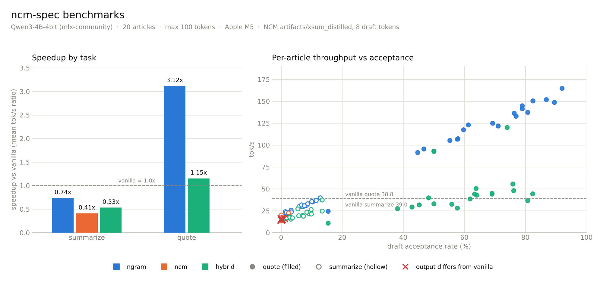
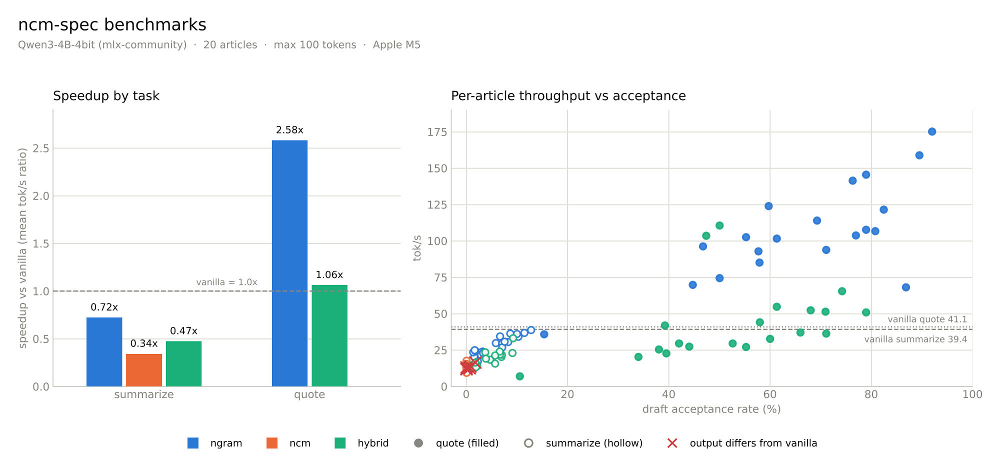

# ncm-spec

Speculative decoding for local LLMs on Apple Silicon, with drafts that come from
a fast coarse-to-fine text model instead of a second autoregressive LLM.

## The short version

I wanted to know one thing: can a tiny concept-level model draft whole
passages for a big local LLM and make it faster on a Mac? This repo is the
answer, told honestly.

**The idea.** A small, fast "assistant" model ([NCM](https://arxiv.org/abs/2610.14162))
guesses what the big model (Qwen3) is about to say, writing its whole guess
in one shot. Qwen checks the entire guess in a single forward pass instead
of writing one token at a time. When the guess is right, generation gets
much faster. When it is wrong, you lose time, because checking a bad guess
costs more than normal decoding.

**What I did.** Two rounds. In v0.1 I ported the released NCM checkpoint to
pure MLX (summaries byte-identical to the PyTorch original) and built the
speculative decoding harness for mlx-lm. The released drafter never matched
even Qwen's first token. So in v0.2 I had the assistant study: I recorded
Qwen writing 10,334 summaries overnight, then fine-tuned the drafter on
them for 3,000 steps, about 14 hours, on this same Mac.

**What happened.** The studying half worked. The drafter now opens with
Qwen's exact words about half the time. On one held-out article both start
"Prison Link Cymru..." word for word. But the drafter stays correct for only
about two tokens on average before the two models part ways, and two
correct tokens per response cannot pay for the checking. Summarization is
still slower than normal decoding: 0.41x, up from 0.34x.

Meanwhile the simple fallback, copying phrases that already appear in the
context (n-gram lookup), works well whenever the output repeats anything:
**3.12x on a quote task, with token-identical output.**

**Bottom line:**

- **Faster Qwen on repetitive tasks (3.12x).** Works today, and to my
  knowledge this is the first public n-gram speculative decoding for mlx-lm
  ([open feature request](https://github.com/ml-explore/mlx-lm/issues/1497)).
- **Not faster on freeform summarization (0.41x).** The drafter can learn
  the target's style but not its exact words beyond a couple of tokens, and
  exact words are what speculative decoding pays for.
- The machinery itself (batched verification, acceptance, KV rewind) is
  proven correct: an oracle drafter reaches 1.00 acceptance. The limit is
  guessing accuracy, and fixing that needs a bigger generator or much more
  training, not a code change.

Everything below is the evidence: how it works, benchmark tables, and the
complete pipeline to reproduce both rounds on your own target model.

## How it works

A small NCM model writes a whole passage in a handful of parallel steps;
the target model (Qwen3 via [mlx-lm](https://github.com/ml-explore/mlx-lm))
verifies the entire draft in one forward pass and accepts the longest exact
greedy match. The runtime is pure [MLX](https://ml-explore.github.io/mlx/):
no CUDA, no torch at inference time.

```
            ┌──────────────── drafter (drafts whole spans) ───────────────┐
            │                                                              │
 prompt ────┤  n-gram lookup over context    or   NCM concept model        │
            │  (verbatim continuation)          (novel continuation)      │
            └──────────────────────────┬───────────────────────────────────┘
                                       │ draft tokens
                                       ▼
            target: one forward pass over [last token + draft]
            accept longest exact greedy match + 1 bonus token
            reject the rest, rewind the KV cache, try again
```

Because acceptance only ever commits tokens the target itself would have
chosen greedily, output matches greedy decoding token for token, up to the
last bit numerics of the target's quantized matmuls (I measure this per run
in the benchmark below).

## What is in the box

- **MLX port of the NCM XSum checkpoint** (88M generator + 60M VQ-VAE
  tokenizer from `hazyresearch/ncm-checkpoints`, MIT). Faithful down to the
  interpolation matrices, quantizer inference without EMA, per-level RoPE and
  the tied-codebook heads. Parity tests produce summaries byte identical to
  the original PyTorch code.
- **A speculative decoding harness** for mlx-lm: batched greedy verification,
  KV cache rewind, joint re-tokenization with a BPE prefix-stability guard
  for drafts given as text.
- **Three drafters**: prompt-lookup n-gram (no ML model), NCM, and a hybrid
  that picks whichever can offer a draft.
- **Benchmarks** that measure tok/s, acceptance, and output identity per task.

## Results (Apple M5, 32 GB, Qwen3-4B-4bit, 20 XSum articles)

v0.1, original released drafter:

| task | method | tok/s | speedup | acceptance | identical to vanilla |
|---|---|---|---|---|---|
| quote passage | vanilla | 41.1 | 1.00x | – | – |
| quote passage | ngram | **106.0** | **2.58x** | 0.67 | 20/20 |
| quote passage | hybrid | 43.6 | 1.06x | 0.53 | 20/20 |
| summarize article | vanilla | 39.4 | 1.00x | – | – |
| summarize article | ngram | 28.4 | 0.72x | 0.06 | 20/20 |
| summarize article | NCM | 13.4 | 0.34x | 0.00 | 17/20 |

v0.2, same harness with the distilled drafter (8 token draft cap):

| task | method | tok/s | speedup | acceptance | identical to vanilla |
|---|---|---|---|---|---|
| quote passage | ngram | **121.1** | **3.12x** | 0.67 | 20/20 |
| quote passage | hybrid | 44.8 | 1.15x | 0.59 | 20/20 |
| summarize article | NCM distilled | 16.1 | 0.41x | 0.01 | 17/20 |
| summarize article | hybrid | 20.8 | 0.53x | 0.06 | 19/20 |

Reproduce with `uv run python -m ncm_spec.bench --articles 20` and
`uv run python -m ncm_spec.bench --articles 20 --ncm-artifacts artifacts/xsum_distilled`.
Raw per article numbers land in `results/benchmark.json` and
`results/benchmark_distilled.json`.



*v0.2 in one picture: distillation moved the drafter from zero agreement to a
two-token median, but speculative decoding breaks even only past roughly five
matched tokens, so freeform summarization stays below 1.0x while
context-copying tasks reach 3.12x.*



*Left: mean speedup per task. Right: throughput per article against draft
acceptance. Speedup tracks acceptance almost perfectly, which is the whole
story of speculative decoding. Red ✕ marks runs whose output differs from
vanilla (batched-verification numerics on the quantized target, not a
correctness bug; see the note below the table).*

Three honest findings:

1. **n-gram drafting is the workhorse.** Wherever the output repeats context
   (quoting, editing, structured formats), acceptance is high and the
   speedup is large (up to 3.12x here). To my knowledge this is the first
   public n-gram speculative decoding for mlx-lm ([open feature
   request](https://github.com/ml-explore/mlx-lm/issues/1497)).
2. **The released NCM XSum drafter does not match Qwen's greedy summaries.**
   It was trained to write its *own* summaries and diverges from token one,
   so exact-match acceptance is zero on freeform summarization. The machinery
   is proven correct (an oracle drafter reaches 1.00 acceptance, 12 of 16
   tokens per round).
3. **Distillation closes the opening, not the gap.** Fine-tuning the
   generator on 10,334 Qwen3 summaries (3,000 steps, ~14 hours on this Mac)
   lifts teacher-forced code accuracy from ~0.15 to 0.52 and makes the
   drafter open with Qwen's exact words on about half of unseen articles.
   But sequence agreement is what speculative decoding pays for, and the
   drafts now agree with the target for 2 tokens on average (median 1,
   max 8) before diverging for good. A static draft can only earn back its
   aligned prefix; every round after that pays verification cost for
   nothing, which is why end-to-end acceptance stays near zero (0.01) and
   summarization is still slower than vanilla (0.41x). The binding
   constraint is sequence-level agreement, and an 88M generator on 10k
   examples does not reach it. Raising it likely needs a larger generator,
   two orders of magnitude more distillation data, and re-drafting each
   round conditioned on what was already accepted; that is future work.

## Quickstart

Requires an Apple Silicon Mac and [uv](https://docs.astral.sh/uv/).

```bash
git clone https://github.com/GarretTomlin/ncm-spec
cd ncm-spec
uv sync --extra dev
uv run python scripts/download_models.py      # ~3 GB: NCM ckpts, GPT-2, Qwen3-4B-4bit
uv run python -m ncm_spec.convert artifacts/xsum
uv run pytest                                 # parity + harness tests
uv run python -m ncm_spec.bench --articles 20
uv run python examples/summarize.py 0
```

Distilling the drafter on your own target (this is how I built v0.2, about
18 hours end to end on an M5):

```bash
uv run python scripts/generate_distill_data.py          # Qwen3 greedy summaries, ~5 h
uv run python -m ncm_spec.train --data data/distill_summaries.jsonl \
    --steps 3000 --batch 16 --lr 2e-5 --out artifacts/xsum_distilled   # ~14 h
uv run python -m ncm_spec.bench --articles 20 \
    --ncm-artifacts artifacts/xsum_distilled
```

Or skip the training and use the distilled drafter I published:

```bash
hf download garrettom/ncm-spec-xsum-distilled --local-dir artifacts/xsum_distilled
uv run python -m ncm_spec.bench --articles 20 \
    --ncm-artifacts artifacts/xsum_distilled
```

Using the harness on its own (no NCM):

```python
from ncm_spec.spec import SpeculativeGenerator, NGramDraftAdapter
from ncm_spec.target import Target

target = Target("mlx-community/Qwen3-4B-4bit")
prompt = target.tokenizer.apply_chat_template(
    [{"role": "user", "content": "your prompt"}],
    add_generation_prompt=True,
    enable_thinking=False,
)
gen = SpeculativeGenerator(target, NGramDraftAdapter(num_pred=12), max_draft_tokens=12)
tokens, stats = gen.generate(prompt, max_tokens=256)
print(target.tokenizer.decode(tokens), stats.acceptance)
```

## How the NCM port stays honest

`MLX_ENABLE_TF32=0` is set by the package: MLX otherwise runs fp32 matmuls
through TF32 tensor cores, which was enough to flip nearest-code assignments
in the VQ quantizer. I measured 40% divergence before the flag. With it, the
full pipeline (VQ encode, multiscale residual quantization, level-by-level
generation, penalized decoding) matches the PyTorch reference in fp32 to
under 1e-5, and the parity tests pin it.

## Project layout

```
src/ncm_spec/
  mlx/          NCM in MLX: ops, quantizer, VQ-VAE, generator
  ncm_drafter.py    article -> draft summary
  target.py         mlx-lm wrapper: batched verify, KV rewind
  spec.py           speculative loop + n-gram / NCM / hybrid drafters
  retokenize.py     text draft -> token draft with stability guard
  bench.py          benchmark runner
  train.py          generator distillation on target summaries
vendor/ncm/         upstream PyTorch reference (MIT), used by parity tests only
```

## Credits

- Kumbong et al., *Next-Concept Modeling: Fast, Parallel Coarse-to-Fine Text
  Generation* (arXiv:2610.14162), and their MIT licensed
  [reference code and checkpoints](https://github.com/HazyResearch/ncm).
- The MLX and mlx-lm teams.

MIT licensed. See NOTICE for vendored code attribution.
